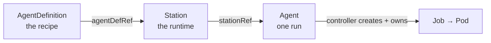
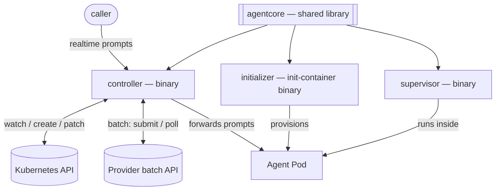

# AI agent subsystem

**The cheapest, most boring way to run coding agents on Kubernetes.**

A run *is* a Kubernetes resource. Create an `Agent`, and a reconciling controller runs Claude Code,
Codex or Gemini CLI against your repo and writes the result to the Agent's `status`. Nothing else
to operate: no database, no backend service, no UI to host.

Documentation: https://re-cinq.github.io/ai-agent-subsystem/

## Why this one

- **Half-price runs, no pod.** A recipe with `execution: batch` skips the Job entirely: the
  controller sends the prompt to the vendor's batch API (Anthropic, OpenAI or Gemini) at about half
  the price and records the answer on the Agent, the same as a pod run would.
  [Batch runs](https://re-cinq.github.io/ai-agent-subsystem/tasks/batch-runs/)
- **An install your security team will sign off.** One `kubectl apply` of a release
  `install.yaml` with images pinned by digest, cosign-signed, with SPDX SBOMs and SLSA provenance.
  The controller runs non-root on a read-only root filesystem with every capability dropped, behind
  a NetworkPolicy. No cert-manager, no admission webhooks; the three binaries are statically
  linked.
- **Kubernetes is the whole API.** Callers create `Agent` resources and read their `status`;
  `ModelCatalog` lists the models your keys can reach. RBAC, quotas, GitOps and audit logs are the
  ones you already run. The one exception is opt-in: realtime sessions take follow-up prompts over
  an HTTP endpoint on the controller.

## Quickstart

You need a Kubernetes cluster (v1.27+), `kubectl`, an Anthropic API key, and a checkout of this
repository for the example files:

```sh
kubectl apply -f https://github.com/re-cinq/ai-agent-subsystem/releases/latest/download/install.yaml
kubectl -n ai-agents create secret generic agent-secrets --from-literal=ANTHROPIC_API_KEY=sk-ant-...
kubectl apply -n ai-agents -f examples/story-writer.yaml
examples/run-agent.sh story-writer title="The Last Lighthouse"
```

The script prints the Agent's name; `kubectl -n ai-agents get agent <name> -o yaml` shows its
`status.output` once the phase reads `Succeeded`. The [`examples/`](examples/) directory has a
code-editing recipe too.

## Use it from your language

You never touch D. The CRDs are the API, and typed clients are generated from the same source that
generates the CRDs, so they cannot drift:

- **YAML / kubectl / GitOps**: apply `AgentDefinition`, `Station` and `Agent` manifests like any other
  resource ([CRD reference](https://re-cinq.github.io/ai-agent-subsystem/reference/crd-agent/)).
- **TypeScript**: [`@re-cinq/agent-contracts`](packages/agent-contracts/) has the types plus a
  small client (`createAgent`, `waitForAgent`, `getModelCatalog`, ...).

  ```sh
  npm install @re-cinq/agent-contracts
  ```

D matters only if you change the API itself; [CONTRIBUTING.md](CONTRIBUTING.md) covers the
toolchain, and [ADR-001](adrs/ADR-001-language-choice.md) explains the choice.

## Install in detail

You need a Kubernetes cluster (v1.27+), `kubectl`, and permission to create cluster-scoped
resources. One apply stands the whole subsystem up in its own `ai-agents` namespace — CRDs, RBAC,
NetworkPolicy and the controller — with both images pinned to the cosign-signed digests that release
built:

```sh
kubectl apply -f https://github.com/re-cinq/ai-agent-subsystem/releases/latest/download/install.yaml
```

Helm users can install the same objects from the signed OCI chart,
`helm install ai-agent-subsystem oci://ghcr.io/re-cinq/charts/ai-agent-subsystem --namespace default`
(see the [install guide](https://re-cinq.github.io/ai-agent-subsystem/setup/install/#install-with-helm)).

Verify the controller is up and reconciling:

```sh
kubectl -n ai-agents get deploy,pods
kubectl -n ai-agents logs deploy/agent-controller
```

Agents call a model provider, so before a run can succeed create an `agent-secrets` Secret in the
`ai-agents` namespace and reference its keys from your recipe — see the
[install guide](https://re-cinq.github.io/ai-agent-subsystem/setup/install/).

With the controller running, define your first recipe from the [`examples/`](examples/).

### Build your own images

Not needed to install — the published images are public. Do this only when your cluster must pull
from a private or air-gapped registry. The published images are multi-arch (linux/amd64 and
linux/arm64). You need Docker (with Buildx); both images build from the repo root — build them for
the platforms your nodes run, tag for **your** registry, and push:

```sh
REGISTRY=your-registry.example.com/your-project   # a registry your cluster can pull from
TAG=v0.14.0

docker buildx build --platform linux/amd64,linux/arm64 --push \
  -f deploy/Dockerfile.controller       -t "$REGISTRY/ai-agent-controller:$TAG" .
docker buildx build --platform linux/amd64,linux/arm64 --push \
  -f scripts/container/Dockerfile.agent -t "$REGISTRY/ai-agent:$TAG"            .
```

Building a platform other than the host's needs QEMU `binfmt` registered (`docker run --privileged
--rm tonistiigi/binfmt --install arm64`) or a native builder of that architecture; drop the one you
do not need from `--platform` to skip it.

Point the manifests at your images. The controller image is set via the kustomize `images:` override
in [`deploy/kustomization.yaml`](deploy/kustomization.yaml); the agent runtime the controller injects
into each run pod is the `AGENT_IMAGE` env in [`deploy/controller.yaml`](deploy/controller.yaml):

```sh
( cd deploy && kustomize edit set image ghcr.io/re-cinq/ai-agent-controller="$REGISTRY/ai-agent-controller:$TAG" )
# then set AGENT_IMAGE in deploy/controller.yaml to "$REGISTRY/ai-agent:$TAG"
```

If your registry needs credentials to pull, create an image pull secret in the `ai-agents` namespace
and reference it from the controller Deployment (and the injected run pods). Then apply the
kustomization instead of the release artifact:

```sh
kubectl apply -k deploy
```

See the [install guide](https://re-cinq.github.io/ai-agent-subsystem/setup/install/) for more detail.

## The model

Three Custom Resources reference each other in a chain:



- **AgentDefinition** — the recipe: prompt template, model, allowed tools, permissions, output sinks.
- **Station** — the runtime: a Pod template plus a recipe reference and run-history limits.
- **Agent** — one run: a Station reference, parameters, the run's own wiring, and a lifecycle `status`.

**Recipe vs run.** An AgentDefinition is reusable by any number of Agents, so what is specific to one
run goes on the Agent: `spec.repos`, `spec.conversation`, `spec.output` (`sinks`, `select`, `watch`),
`spec.secrets` and `spec.env`, next to `model`, `parameters` and `files`. The controller resolves a
run's effective spec from Station → AgentDefinition → Agent, in that order, before it builds the Job,
and a value the Agent sets wins over the recipe's, which is the default:

| Agent field | Combines with the recipe's value by |
| --- | --- |
| `model`, `repos`, `output.sinks`, `output.select` | replacing it when the Agent sets one |
| `conversation` | replacing each of `source`, `id`, `pin` and `headers_secret` the Agent sets |
| `secrets`, `env`, `output.watch` | replacing the entry with the same `name` (`event` for a watch), keeping and adding the rest |

An Agent that sets none of these runs the recipe unchanged. The prompt is still rendered once, from
the recipe's `prompt` and the Agent's `parameters`, when the Job is created, and nothing changes in a
running Job. [`examples/shared-recipe.yaml`](examples/shared-recipe.yaml) has two Agents sharing one
AgentDefinition.

The controller watches Agents, builds a Job per run, supervises it, patches the Agent's status, and
prunes old runs. The agent toolchain is *injected* into the run Pod, so Stations only need a
glibc-based base image. A recipe with `execution: batch` skips the Pod: the controller sends the
prompt to the batch API of the model's vendor (Anthropic, Gemini or OpenAI) itself, at about half
the price, and records the result
in the Agent's status ([batch runs](https://re-cinq.github.io/ai-agent-subsystem/tasks/batch-runs/)).
Batch is opt-in: install with the `deploy/components/batch` kustomize component, which also grants
the controller read access to the `agent-secrets` Secret.

A recipe with `execution: realtime` keeps the agent CLI running in its Pod and takes further prompts
over HTTP through the controller, one turn at a time, until the session is closed or idles out. It
saves the conversation under its session id (`status.sessionId`), and a later Agent with
`spec.resumeSession` continues it
([realtime sessions](https://re-cinq.github.io/ai-agent-subsystem/tasks/realtime-sessions/)). Realtime
is opt-in through the `deploy/components/realtime` kustomize component.

A fourth, controller-owned resource, **ModelCatalog** (`kubectl get mc default -n ai-agents`), lists
the models the subsystem can run with the API keys AgentDefinitions map from `agent-secrets`, so an
orchestrator can discover them
([ModelCatalog](https://re-cinq.github.io/ai-agent-subsystem/reference/crd-modelcatalog/)). It is
opt-in through the `deploy/components/model-catalog` kustomize component.

An **AgentSpawner** (`kubectl get asp`) creates an Agent in a Station on a five-field cron schedule,
so recurring work needs no external scheduler
([schedule runs](https://re-cinq.github.io/ai-agent-subsystem/tasks/schedule-runs/)), or for each
signed GitHub webhook delivery it matches, such as an issue getting a label
([trigger runs from GitHub](https://re-cinq.github.io/ai-agent-subsystem/tasks/trigger-from-github/)).
Webhooks are opt-in through the `deploy/components/webhooks` kustomize component.

## Architecture

A single dub monorepo (every package under `packages/`) producing **three runtime binaries** and a
**shared library**, statically linked with LDC, plus `crdgen`/`tsgen` codegen tools:



- **`agentcore`** — CRD types, Kubernetes client, the pure reconcile state machine, prompt
  templating, and the Job builder.
- **`controller`** — the operator: reconciles Agents into Jobs and back, and serves the prompt API
  for realtime sessions.
- **`initializer`** — the init container: clones repos and installs the agent CLI before the run.
- **`supervisor`** — runs inside the Job Pod, supervises the agent process, and streams its output;
  in a realtime session it also takes prompts and runs them turn by turn.
- **`crdgen`** / **`tsgen`** — dev/CI tools that generate `deploy/crds` and the `@re-cinq/agent-contracts`
  TypeScript types from the annotated `agentcore` structs.

## Repository layout

```
ai-agent-subsystem/
├── README.md
├── dub.json       # root: subPackages
├── packages/      # agentcore (lib) + controller, supervisor, initializer (apps); crdgen, tsgen, mockagent, itest (tooling/tests)
├── deploy/        # CRDs (generated), RBAC, controller manifest
├── scripts/       # drift checks, integration-test runners, container builds
└── website/       # documentation site (Astro Starlight)
```

## Documentation site

The docs live in [`website/`](website/) and deploy to GitHub Pages on every push to `main`.

```sh
cd website
npm install
npm run dev      # local preview at http://localhost:4321/
npm run build    # production build
```

> Requires Node.js 22+.

## Contributing

[`CONTRIBUTING.md`](CONTRIBUTING.md) covers the toolchain, the `make` targets for building and
testing, the integration-test tiers, and how the generated CRDs and TypeScript contracts stay in
sync. The [building guide](https://re-cinq.github.io/ai-agent-subsystem/contribute/building/) on
the docs site goes deeper.

## Status

Active development. The controller, supervisor, initializer, and the `agentcore` library are
implemented and covered by unit + integration tests, and tagged releases publish signed, SBOM'd
images plus a one-command `install.yaml`. The CRD APIs are `v1beta1` (pre-GA; `v1alpha1` is still served, deprecated).
See the [roadmap](https://re-cinq.github.io/ai-agent-subsystem/contribute/roadmap/) for direction.

## Releases

Cut a release by bumping the npm package to the version you are about to tag, then pushing the tag:

```sh
(cd packages/agent-contracts && npm version 0.11.0 --no-git-tag-version)  # in the release PR
git tag v0.11.0 && git push origin v0.11.0
```

The bump is part of the release PR, not the tag: `@re-cinq/agent-contracts` publishes the version
committed in its `package.json`. `scripts/check-contracts-version.sh` runs on the tag and fails the
publish if the two disagree, rather than letting npm reject a duplicate version quietly.

The [`Publish images`](.github/workflows/images.yml) workflow builds, pushes, and cosign-signs the
controller and agent images for the tag (each with an SPDX SBOM and SLSA provenance attestation). It
then renders `deploy/` to a single digest-pinned `install.yaml` and attaches it to the GitHub
Release — the artifact end users install with one command:

```sh
kubectl apply -f https://github.com/re-cinq/ai-agent-subsystem/releases/latest/download/install.yaml
```

Finally it opens a PR that pins `deploy/` and the install page's cosign-verify example to the exact
signed digests (sourced from the build, not a mutable tag), so `main` and `kubectl apply -k deploy`
never ship a floating `:latest`. The local equivalent is `scripts/pin-image-digests.sh`.

## License

[Apache-2.0](LICENSE).
