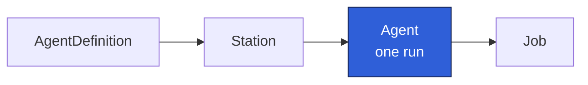

An `Agent` is **one run**. It references a [Station](./station.md), supplies
per-run parameters, and carries a `status` the controller updates as the run progresses.

## Spec

- **`stationRef`**: the Station to run in (which in turn selects the recipe).
- **`parameters`**: a string map used to fill the recipe's `{placeholder}` tokens and passed to the
  agent process.
- **`taskId`**: optional external id for correlation.
- **`model`**: optional model id for this run only. It overrides the recipe's `model` everywhere
  that model is used, including which agent CLI the run selects, so a caller that needs one run on a
  different model does not need a second recipe. Omitted, the recipe's model applies.
- **`targetRepo`** / **`branch`**: optional repo (`owner/name`) and git branch metadata.
- **`files`**: optional per-run input files, by reference: `{path, url, headers_secret?}`. The init
  container downloads each into the workspace before the agent starts, so a run can be handed a
  document without its contents ever sitting in the CR. The recipe says what the agent does; `files`
  and `parameters` are what *this* run does it to.
- **`resumeSession`**: optional `status.sessionId` of an earlier
  [realtime session](../tasks/realtime-sessions.md) to continue. The run restores that conversation and
  waits for prompts instead of sending the recipe's prompt.

Agents are usually created with `generateName` (for example `bug-fixer-run-`) so Kubernetes assigns
a unique name per run.

## Status

The controller owns `status`:

- **`phase`**: `Pending` → `Running` → `Succeeded` | `Failed`.
- **`jobName`**: the Job the controller created.
- **`startedAt`** / **`completedAt`**: run timestamps.
- **`exitCode`**: the process exit code (`0` = success).
- **`output`**: captured summary output (the truncated tail of the pod logs).
- **`failureReason`**: a human-readable reason when the run fails.
- **`prUrl`**: the pull request the run opened, when its definition sets
  [`delivery.pullRequest`](../tasks/open-pull-requests.md).
- **`sessionId`**: the agent CLI's session id, from the run's session events; pass it as another
  Agent's `resumeSession` to continue a realtime session.
- **`batchId`** / **`batchProvider`** / **`batchFallback`** / **`batchCleanupAttempts`**: set only
  for [batch runs](../tasks/batch-runs.md). A batch Agent goes through the same phases, but `Running`
  means its provider batch is in flight rather than a Job, and `jobName` stays empty unless it fell
  back to a Job.

The phase transitions are driven by the controller's reconcile loop; see
[Controller lifecycle](./controller-lifecycle.md). The full field reference
is in [Agent CRD](../reference/crd-agent.md).
