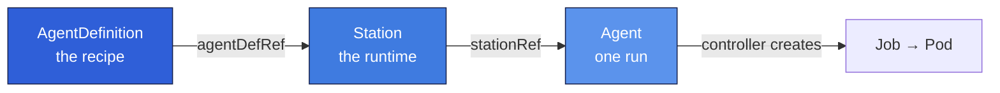

import { Card, CardGrid, LinkCard } from '@astrojs/starlight/components';

## What is the ai agent subsystem?

**ai-agent-subsystem** turns "run a coding agent" into a declarative Kubernetes operation. You
describe *what* the agent should do (a recipe), *where* it runs (a runtime template), and *which*
run you want (parameters). A controller reconciles each run into a Kubernetes `Job`, supervises it,
streams its output, and records the result on the resource's `status`. Kubernetes stays the single
source of truth.

## Why this one

<CardGrid>
	<Card title="Half-price runs, no pod" icon="star">
		`execution: batch` sends the prompt to the vendor's batch API (Anthropic, OpenAI or Gemini) at
		about half the price and records the answer on the Agent. See [batch runs](/ai-agent-subsystem/tasks/batch-runs/).
	</Card>
	<Card title="A signed, pinned install" icon="approve-check">
		One `install.yaml` per release: images pinned by digest, cosign-signed, with SBOMs and SLSA
		provenance. Non-root, read-only root filesystem, NetworkPolicy. No cert-manager.
	</Card>
	<Card title="Kubernetes is the API" icon="puzzle">
		No database, no backend service, no UI to host. Your RBAC, quotas, GitOps and audit logs
		already cover it.
	</Card>
	<Card title="You never touch D" icon="seti:typescript">
		The CRDs are the API. Typed TypeScript contracts are generated from the same source, so they
		cannot drift. D matters only to contributors changing the API.
	</Card>
</CardGrid>

## The three resources

Everything is built from three Custom Resources that reference each other in a chain:

<CardGrid>
	<Card title="AgentDefinition" icon="document">
		The **recipe**: prompt template, model, allowed tools, permissions, and output sinks.
	</Card>
	<Card title="Station" icon="setting">
		The **runtime**: a Pod template plus a recipe reference and run-history limits.
	</Card>
	<Card title="Agent" icon="rocket">
		One **run**: a Station reference, parameters, and a `status` that tracks the lifecycle.
	</Card>
	<Card title="Controller" icon="random">
		Watches Agents, builds Jobs, patches status, and prunes old runs.
	</Card>
</CardGrid>

## Start here

<CardGrid>
	<LinkCard title="How the pieces relate" href="/ai-agent-subsystem/concepts/relationships/" description="The full relationship schema: data model and runtime composition diagrams." />
	<LinkCard title="Architecture" href="/ai-agent-subsystem/concepts/architecture/" description="The D monorepo: three binaries and a shared library, statically linked." />
	<LinkCard title="Install" href="/ai-agent-subsystem/setup/install/" description="One kubectl apply of a signed release manifest stands up the whole subsystem." />
	<LinkCard title="Examples" href="/ai-agent-subsystem/tasks/examples/" description="Worked recipes: a bug-fixer and a pure-text story writer." />
</CardGrid>
